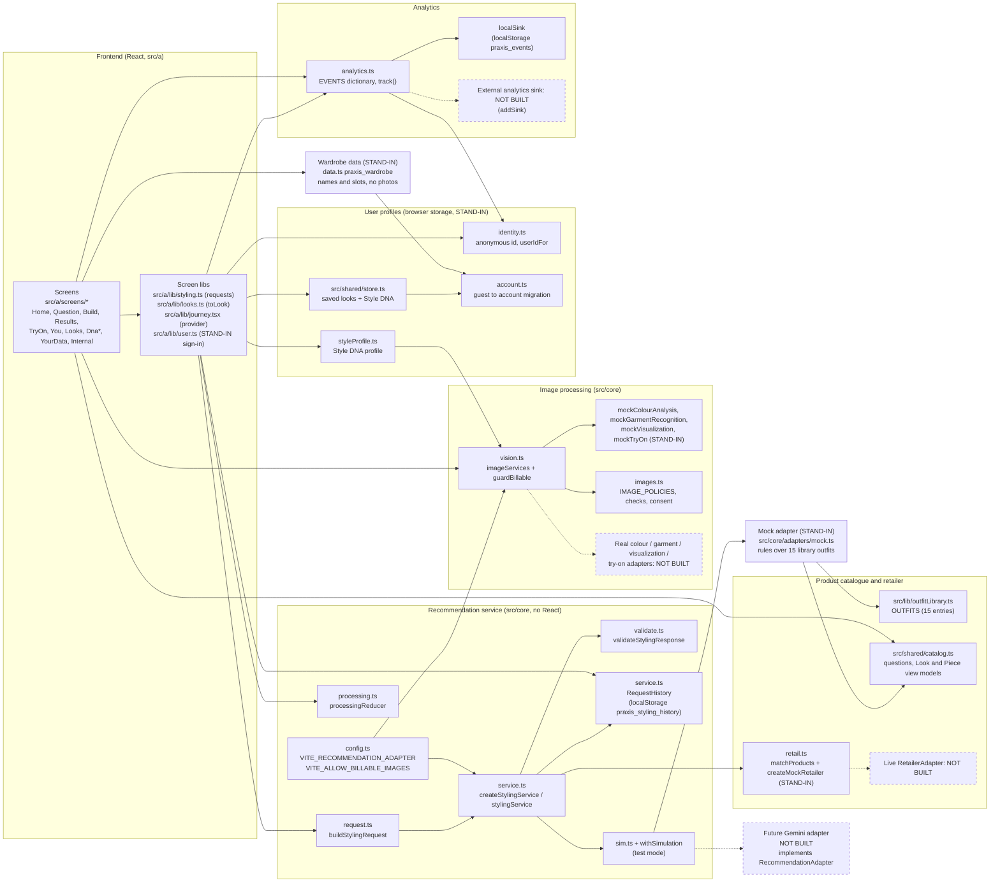
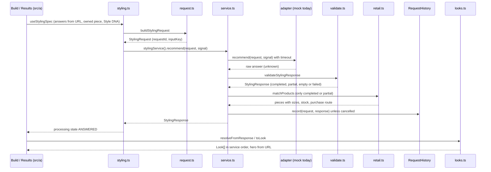

# Praxis architecture (Concept A)

This document describes what the code in this repository does today. It is written from the source, not from plans. Everything runs in the browser: there is no server, no database and no network call to any recommendation, image, retailer, payment or analytics provider in this repository. Where a part is a stand-in, the section says so and names the interface in code that a real implementation plugs into.

Deliverable B of the master spec (section 23) asks for a diagram showing the frontend, the recommendation service, the mock adapter, the future Gemini adapter, the image-processing adapters, the product catalogue, user profiles, wardrobe data and analytics. That diagram is below, followed by one section per box and the lifecycle of a styling request.

## Diagram

Solid boxes exist and run today. Dashed boxes are not built. Boxes marked STAND-IN exist but replace something real (rules instead of a model, fixed samples instead of analysis, browser storage instead of a backend).



## Summary of what is real and what is a stand-in

| Box | Main files | Status today |
|---|---|---|
| Frontend | `src/a/screens/*`, `src/a/lib/*` | Real UI. Sign-in and payment (`src/a/ui/Gate.tsx`, `src/a/lib/user.ts`) are visual previews only. |
| Recommendation service | `src/core/service.ts`, `request.ts`, `validate.ts`, `processing.ts` | Real code, intended to stay. Runs in the browser. |
| Mock adapter | `src/core/adapters/mock.ts` | Stand-in. Fixed rules, not a model. Every response is `mode: "demonstration"`. |
| Future Gemini adapter | none | Not built. Plugs in through `RecommendationAdapter` (`src/core/service.ts:15`). |
| Image processing | `src/core/vision.ts`, `src/core/images.ts` | Interfaces, policies, checks and the billable guard are real. Every adapter is a free mock. |
| Product catalogue and retailer | `src/lib/outfitLibrary.ts`, `src/shared/catalog.ts`, `src/core/retail.ts` | Stand-in. 15 curated outfits, invented houses, example prices, mock retailer with unknown stock and no purchase route. |
| User profiles | `src/core/identity.ts`, `account.ts`, `styleProfile.ts`, `src/shared/store.ts` | Logic is real; persistence is browser storage only; accounts are local stand-ins. |
| Wardrobe data | `src/core/data.ts` | Stand-in persistence (localStorage). Name and slot only, no photo. |
| Analytics | `src/core/analytics.ts` | Dictionary and guard are real. The only sink is local storage. |

## Frontend

Responsibility: draws every journey (Style a Moment, Style DNA, saved looks, your data, the internal analytics page), keeps answers in the URL, and calls into `src/core` for anything that is not UI.

Files:

- Routes: `src/a/ConceptA.tsx:37` (all routes listed there, from `/` to `/internal/analytics`).
- Journey state: `src/a/lib/journey.tsx:18` (`JourneyProvider`) and `src/a/lib/journeyContext.ts:77` (`parseAnswers` reads answers from search params).
- Styling requests from the screens: `src/a/lib/styling.ts` (`useStylingSpec` at :28, `submitStyling` at :80, `useStylingResponse` at :97, `useStylingRun` at :137).
- Response to view model: `src/a/lib/looks.ts:16` (`toLook`) and `:59` (`resolveFromResponse`).
- The build screen runs one request through the processing states: `src/a/screens/moment/Build.tsx:51`.
- Results and try-on read the stored response: `src/a/screens/moment/Results.tsx:64`, `src/a/screens/moment/TryOn.tsx:26`.

Mock vs real: the screens are the real product UI. The sign-in and Premium purchase in `src/a/ui/Gate.tsx` and `GateSteps.tsx` call no identity or payment provider; `src/a/lib/user.ts` writes a local `{ id, name, email, premium }` record. Try-on shows the look on a model and asks for no photo.

The screens never rank, price or explain a look. They show what the service response says, in its order (`src/a/lib/looks.ts:1`).

## Recommendation service

Responsibility: the one entry point the screens use to ask for looks. It sends a `StylingRequest` to the configured adapter, enforces a timeout and cancellation, validates whatever comes back, enriches retail pieces through a retailer adapter, and records the request and response in a history.

Files:

| Part | Location |
|---|---|
| Adapter interface | `src/core/service.ts:15` (`RecommendationAdapter`) |
| Service factory | `src/core/service.ts:38` (`createStylingService`) |
| Test mode wrapper | `src/core/service.ts:81` (`withSimulation`) |
| Request history | `src/core/service.ts:123` (`createRequestHistory`, key `praxis_styling_history`, newest 20) |
| App singleton and adapter choice | `src/core/service.ts:151` (`stylingService`) |
| Request builder | `src/core/request.ts:53` (`buildStylingRequest`), `:37` (`inputKeyFor`) |
| Contracts (version 1.0) | `src/core/contracts.ts:54` (`StylingRequest`), `:188` (`OutfitRecommendation`), `:209` (`StylingResponse`) |
| Validation | `src/core/validate.ts:193` (`validateStylingResponse`), `:178` (`failedResponse`) |
| Processing state machine | `src/core/processing.ts:49` (`processingReducer`); limits at `:33` to `:37` |

```ts
// src/core/service.ts:15
export interface RecommendationAdapter {
  readonly id: string;
  readonly version: string;
  /** Returns the raw answer; the service validates it, so an adapter can never break a screen. */
  recommend(request: StylingRequest, options: { signal?: AbortSignal }): Promise<unknown>;
}
```

Mock vs real: this layer is real and is meant to stay when the adapter changes. It runs in the browser today. Timing constants: slow notice after 5000 ms (`SLOW_AFTER_MS`), timeout after 20000 ms (`TIMEOUT_MS`; 9000 ms, `SIM_TIMEOUT_MS` at `service.ts:101`, when test mode simulates a timeout), at most 3 attempts (`MAX_ATTEMPTS`).

Validation rules worth knowing (`src/core/validate.ts:193` to `:244`):

- A non-object, or a response whose `requestId` or `inputKey` does not match the request, becomes a `failed` response.
- Malformed or duplicate outfits are dropped; ranks are renumbered from 1.
- Fewer than 3 valid outfits (`EXPECTED_OUTFITS`) makes the response `partial`; zero makes it `empty`. Nothing is padded.
- `mode: "personalized"` is only kept when the adapter id is not `"mock"` (`validate.ts:236`); otherwise it is forced to `"demonstration"`.

## Mock adapter (stand-in)

Responsibility: answers styling requests so every input, explanation, look and piece travels through the real contracts.

File: `src/core/adapters/mock.ts`. Entry points `mockRecommend` (`:244`) and `createMockAdapter` (`:288`); id `mock`, version `1.0.0` (`:24`).

What it does: filters `OUTFITS` from `src/lib/outfitLibrary.ts` by occasion, scores each with fixed rules (`score`, `:76`: feel +4, place +2, formality +1, time of day +1 or -1, budget +1), builds garments with invented houses (`HOUSES`, `:90`) and example prices drawn from the chosen budget band (`PRICE_BY_BAND`, `:93`), replaces a slot with the customer's owned piece when one is sent, and writes explanations from the same rules (`explain`, `:210`). Same request, same answer.

Mock vs real: entirely a stand-in. Every response has `mode: "demonstration"`, every price `priceStatus: "example"`, and every image is a library photograph marked `fidelity: "representative"`.

## Future Gemini adapter (not built)

There is no Gemini code in this repository. The only mention is a comment in `src/core/contracts.ts:3`. This section describes where one would plug in, based on the existing interfaces.

How it plugs in:

1. Write a module (for example under `src/core/adapters/`) that exports an object implementing `RecommendationAdapter` (`src/core/service.ts:15`): an `id` other than `"mock"`, a `version`, and `recommend(request, { signal })` that returns an object shaped like `StylingResponse` (`src/core/contracts.ts:209`), echoing the request's `requestId` and `inputKey`.
2. Select it in `stylingService()` (`src/core/service.ts:151`). Today that function always builds the mock and, when `RECOMMENDATION_ADAPTER` is anything other than `"mock"`, logs a warning and still uses the mock (`service.ts:153`). A branch on the config value is needed there.
3. Set `VITE_RECOMMENDATION_ADAPTER` at build time. It is read in `src/core/config.ts:21` and defaults to `"mock"`. It is a Vite build variable, so a visitor cannot change it (`config.ts:2`).

What does not change: request building, validation, product matching, history, the processing states and every screen. The validator already drops malformed looks and is the only place `mode: "personalized"` can be accepted.

What is not present and would be needed: `VITE_*` values are compiled into the browser bundle, so a provider key cannot be kept there. A real model adapter would need a server or proxy to call, and none exists in this repository. That server, its endpoint and its authentication are not designed here.

## Image-processing adapters

Responsibility: provider-independent interfaces for colour analysis of a face photo, garment recognition from a wardrobe photo, outfit visualization and virtual try-on; the policy for each kind of personal photo; file and quality checks; consent records; and one switch that blocks paid calls.

Files:

| Part | Location |
|---|---|
| Adapter interfaces | `src/core/vision.ts:70` (`ColourAnalysisAdapter`), `:73` (`GarmentRecognitionAdapter`), `:76` (`OutfitVisualizationAdapter`), `:79` (`TryOnAdapter`); each has `id`, `version`, `billable` (`:63`) |
| Mocks | `src/core/vision.ts:86`, `:104`, `:129`, `:138` |
| Billable guard | `src/core/vision.ts:157` (`guardBillable`), throws `BillableCallBlocked` (`:149`) |
| Registry | `src/core/vision.ts:165` (`imageServices`) |
| Switch | `src/core/config.ts:27` (`ALLOW_BILLABLE_IMAGES`, true only when `VITE_ALLOW_BILLABLE_IMAGES=true`) |
| Photo policies | `src/core/images.ts:45` (`IMAGE_POLICIES`) |
| Checks | `src/core/images.ts:125` (`checkFile`), `:134` (`checkQuality`) |
| Consent | `src/core/images.ts:163` to `:178` (`consentFor`, `grantConsent`, `withdrawConsent`) |

```ts
// src/core/vision.ts:157
export function guardBillable(adapter: Adapter, allowed: boolean = ALLOW_BILLABLE_IMAGES): void {
  if (adapter.billable && !allowed) throw new BillableCallBlocked(adapter.id);
}
```

Every call in `imageServices` goes through `guardBillable`. A blocked colour or garment call returns `{ status: "disabled" }`; a blocked visualization or try-on returns a `GeneratedImage` with `status: "disabled"`. Try-on also returns that while `IMAGE_POLICIES.try_on.status` is not `"collecting"` (`vision.ts:205`), which is the case today.

Mock vs real: every adapter is a free mock (`billable: false`). `mockColourAnalysis` returns the same sample (`undertone: cool`, `contrast: high`, `source: "sample"`) for every face photo. Garment recognition reads nothing. Visualization and try-on generate nothing. The only screen that calls `imageServices` today is `src/a/screens/dna/DnaResult.tsx:49`. Photos stay in sessionStorage for the tab and are never sent anywhere. No billable adapter exists. Real adapters plug in by passing them to `imageServices({ colour, garment, visualization, tryOn })`.

## Product catalogue and retailer adapter

Responsibility: the outfits the mock can recommend, the question options and view models the screens draw, and the step that asks a retailer about sizes, stock and how to buy each retail piece.

Files:

| Part | Location |
|---|---|
| Outfit library (15 entries with photo, tags and item names) | `src/lib/outfitLibrary.ts:30` (`OUTFITS`) |
| Question options | `src/shared/catalog.ts:20` (`OCCASIONS`), `:34` (`VENUES`), `:68` (`TIMES`), `:89` (`VIBES`), `:96` (`SPEND`) |
| View models | `src/shared/catalog.ts:106` (`Piece`), `:129` (`Look`) |
| Retailer interface | `src/core/retail.ts:24` (`RetailerAdapter`) |
| Mock retailer | `src/core/retail.ts:49` (`createMockRetailer`) |
| Merge into the response | `src/core/retail.ts:73` (`matchProducts`) |
| Helpers used by check out | `src/core/retail.ts:115` (`stockFor`), `:121` (`canPurchase`) |

```ts
// src/core/retail.ts:24
export interface RetailerAdapter {
  readonly id: string;
  lookup(products: readonly ProductRef[], options?: { signal?: AbortSignal }): Promise<RetailerProductInfo[]>;
}
```

Mock vs real: a stand-in. The houses are invented, prices are examples inside the chosen budget, and the mock retailer returns sizes per slot, `availability: "unknown"` and `purchase: { kind: "none", reason: "example_product" }`, so nothing can be bought. Test mode can mark shoes sold out (`service.ts:155`). `matchProducts` keeps the original pieces if the lookup throws, and only replaces a price when the retailer also gives a `priceStatus` (`retail.ts:100`). A live retailer feed plugs in as another `RetailerAdapter` passed as `retailer` to `createStylingService`. None exists.

## User profiles

Responsibility: who the visitor is, the Style DNA profile, saved looks, and moving a guest's data onto an account at sign-in.

Files:

| Part | Location |
|---|---|
| Anonymous id (`praxis_anon`) | `src/core/identity.ts:33` (`anonymousId`), `:49` (`noteVisit`) |
| Stand-in account id per email (`praxis_lab_a_accounts`) | `src/core/identity.ts:66` (`userIdFor`), `:77` (`currentUserId`) |
| Guest to account migration (pure functions) | `src/core/account.ts` (`visibleTo`, `migrateLooks`, `migrateFeedback`) |
| Style DNA profile | `src/core/styleProfile.ts:21` (`StyleProfile`), `:41` (`valueOf`: correction, then confirmation, then estimate), `:135` (`profileRef`), `:139` (`summarize`) |
| Saved looks and saved Style DNA (`praxis_lab_a`) | `src/shared/store.ts:95` (`useLabStore`) |
| Migration on sign-in | `src/a/lib/journey.tsx:43` to `:51` |

Mock vs real: the profile model and migration rules are real. Persistence is localStorage only, and identity is a local stand-in: `userIdFor` keeps a random id per email address in this browser with no server. A real identity provider (the README names Clerk) would replace `userIdFor` and `src/a/lib/user.ts`; none is wired. The profile never holds a photo; requests carry `profileId_vVersion` and a summary of values with their basis (`request.ts:53`, `styleProfile.ts:139`).

## Wardrobe data

Responsibility: remembers pieces the customer owns, by slot and name, so the looks can be rebuilt around one.

Files: `src/core/data.ts:127` (`WardrobeEntry`), `:140` (`rememberWardrobeItem`), `:151` (`forgetWardrobeItem`), `:156` (`migrateWardrobe`). Written from `src/a/screens/moment/You.tsx:68`. Key `praxis_wardrobe`, newest 50.

Mock vs real: stand-in persistence. No photo is stored here; an owned piece's photo stays in sessionStorage (`praxis_lab_a_item`). The piece reaches the engine as a `WardrobeItemRef` in `StylingRequest.wardrobeItems` (`request.ts:32`, `contracts.ts:26`), with an id made of the slot and a hash of source, label and content (`wardrobeRef`). Garment recognition from the photo is not done (see Image processing). The same file also holds retention (`RETENTION`, `:12`), the list of every storage key (`STORES`, `:30`), pruning on start (`pruneExpired`, `:66`) and delete everything (`deleteLocalData`, `:81`).

## Analytics

Responsibility: records product events against a closed dictionary and refuses anything that could carry personal data.

Files: `src/core/analytics.ts:36` (`EVENTS`), `:130` (`validateEvent`), `:159` (`createLocalSink`), `:175` (`addSink`), `:192` (`track`). Read by `src/a/screens/Internal.tsx:31`.

```ts
// src/core/analytics.ts:116
export interface AnalyticsSink {
  send(event: PraxisAnalyticsEvent): void;
}
```

Mock vs real: the dictionary and the guard are real. Unknown events or properties, missing or mistyped values, and strings that are empty, over 160 characters, contain `@` or `base64`, or start with `data:` or `blob:` are refused (`analytics.ts:124`). Each event carries an event id, time, anonymous id, user id when signed in, journey, app version and `testMode` when test mode is on. The only sink is `localSink` (localStorage `praxis_events`, newest 1000). An external analytics service plugs in with `addSink`; none is registered.

## Request lifecycle: from answers to results



Step by step:

1. Answers. Each question writes to the URL search params (`occasion, venue, time, vibe, spend, item, hero`). `parseAnswers` (`src/a/lib/journeyContext.ts:77`) reads them back. `useStylingSpec` (`src/a/lib/styling.ts:28`) returns null until every question has an answer (`completeInputs`, `src/core/request.ts:19`), then adds the owned piece as a `WardrobeItemRef` and the Style DNA as `profileRef`.
2. Request. `requestFor` (`styling.ts:43`) calls `buildStylingRequest` (`request.ts:53`) with the anonymous id, user id, wardrobe, Style DNA summary and a preference snapshot from feedback (`src/core/feedback.ts:87`). Budgets become numbers (`BUDGET_BOUNDS`). `inputKey` (`request.ts:37`) joins the answers, owned piece ids and profile reference; preferences are not part of it.
3. Service. `send` (`styling.ts:56`) tracks `styling_submitted` and `processing_started`, then calls `stylingService().recommend`. The service (`service.ts:38`) starts a timer and an `AbortController`, and calls the adapter through `withSimulation`.
4. Validate. The raw answer goes through `validateStylingResponse` (`service.ts:58`). A throw becomes `failed` with code `timeout`, `cancelled` (not retryable) or `adapter_error` (`service.ts:64` to `:66`).
5. matchProducts. For `completed` or `partial` responses the retailer adapter is asked about every retail piece (`service.ts:60`). A failed lookup leaves the pieces unchanged.
6. History. Unless cancelled, the pair is stored (`service.ts:71`) in `praxis_styling_history`. `styling.ts` also keeps the last answer per `inputKey` in memory, including failures, and deduplicates requests already in flight (`styling.ts:70` to `:86`).
7. Processing states. On the build screen `useStylingRun` (`styling.ts:137`) drives `processingReducer`: `validating`, `submitted`, `processing`, `delayed` after 5 s, then `completed`, `partial`, `empty`, `failed` (Try again) or `retry_exhausted` after 3 attempts or a non-retryable failure; Cancel moves to `cancelled` and a late answer is ignored. Each try is a new request with its own id.
8. toLook. Results and try-on call `useStylingResponse` (`styling.ts:97`), which reuses the newest non-failed history entry for the same `inputKey` (or this tab's last failure for it) and only sends a new request when there is neither (for example a shared link). `resolveFromResponse` (`src/a/lib/looks.ts:59`) maps each `OutfitRecommendation` through `toLook` (`looks.ts:16`) into the `Look` and `Piece` view models, keeping the service's order and picking the `hero` from the URL as the look in front (the first look when there is none). Saving a look stores its `recommendationId`, `requestId` and `inputKey` (`src/a/screens/moment/Results.tsx:80`).

## Where real integrations plug in

| Integration | Interface in code | Selected or registered at | Exists today |
|---|---|---|---|
| Recommendation engine (Gemini or other) | `RecommendationAdapter`, `src/core/service.ts:15` | `stylingService()`, `service.ts:151`; `VITE_RECOMMENDATION_ADAPTER`, `config.ts:21` | No, mock only |
| Colour analysis | `ColourAnalysisAdapter`, `src/core/vision.ts:70` | `imageServices({ colour })`, `vision.ts:165` | No, sample only |
| Garment recognition | `GarmentRecognitionAdapter`, `vision.ts:73` | `imageServices({ garment })` | No |
| Outfit visualization | `OutfitVisualizationAdapter`, `vision.ts:76` | `imageServices({ visualization })` | No |
| Virtual try-on | `TryOnAdapter`, `vision.ts:79` | `imageServices({ tryOn })`, also needs `IMAGE_POLICIES.try_on.status = "collecting"` | No |
| Paid image calls | `guardBillable`, `vision.ts:157` | `VITE_ALLOW_BILLABLE_IMAGES`, `config.ts:27` (off by default) | Switch exists, nothing billable |
| Retailer feed | `RetailerAdapter`, `src/core/retail.ts:24` | `createStylingService(..., { retailer })`, `service.ts:155` | No, mock only |
| Analytics service | `AnalyticsSink`, `src/core/analytics.ts:116` | `addSink`, `analytics.ts:175` | No, local sink only |
| Identity | `userIdFor` / `currentUserId`, `src/core/identity.ts:66`, `:77`; `src/a/lib/user.ts` | replace the stand-in | No, local stand-in |
| Payment | `src/a/ui/Gate.tsx`, `GateSteps.tsx` | replace the preview | No, visual preview |
| Persistence (looks, DNA, wardrobe, history, feedback) | `useLabStore`, `src/shared/store.ts:95`; `data.ts`; `feedback.ts`; `RequestHistory` | replace localStorage | No, browser storage only |
